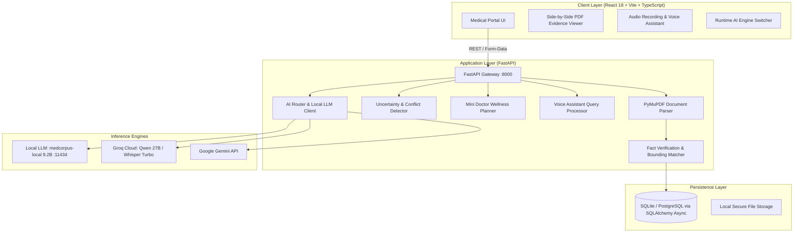

# 🩺 MedCorpus AI — Intelligent Medical Report Summarization

[](https://opensource.org/licenses/MIT)
[](https://python.org)
[](https://fastapi.tiangolo.com)
[](https://react.dev)
[](https://www.typescriptlang.org)
[](https://vitejs.dev)

> **CBC 2.0 Hackathon** | **Domain:** AI & ML | **Team:** BINARY BUILDERS (Team ID: CBC060)  
> **Problem Statement 17:** Intelligent Medical Report Summarization

---

## 🌟 Executive Summary

Medical diagnostic reports (pathology panels, CBC, lipid profiles, metabolic tests) are often dense, multi-page PDFs packed with medical jargon, confusing abbreviations, and complex reference ranges. Patients struggle to understand their results, while clinicians spend valuable consultation time explaining routine laboratory figures.

**MedCorpus AI** solves this challenge by transforming unstructured diagnostic documents into verifiable, plain-language summaries. It enforces a strict clinical safety principle: **complete separation of verified objective facts from generated AI interpretation**, with 100% trace-back grounding to the source document passages.

---

## 🚀 Key Features & Innovations

### 1. 🔍 Strict Separation of Facts vs. Interpretation
- **Extracted Facts**: Every lab biomarker (e.g. Hemoglobin, HbA1c, Fasting Glucose) is extracted deterministically using **PyMuPDF**, paired with its exact biological reference interval, page number, and verbatim document quote.
- **AI Synthesis**: Interpretations and summaries are generated by connected medical LLMs and clearly quarantined with safety tags, ensuring zero speculative hallucinations.

### 2. 📄 Interactive Grounding & PDF Viewer
- Side-by-side inspection of extracted facts alongside the original multi-page PDF.
- Clicking any biomarker instantly navigates the PDF viewer to the exact page and passage where the result was measured.

### 3. 👥 Role-Based Perspectives
- **🩺 Clinical View (Healthcare Professionals)**:
  - High-privilege access designed for doctors, nurses, and lab pathologists.
  - Review all extracted biomarkers, execute clinical overrides on disputed values with audit notes, and officially sign off reports with physician license numbers.
- **👤 Patient View (Patients & Caregivers)**:
  - Jargon-free, empathetic explanations translated into plain language.
  - Interactive companion Q&A answering patient follow-up questions grounded strictly in their actual report.

### 4. 📊 Baseline Facts Trend Visualization
- An interactive, normalized baseline chart mapping all extracted lab measurements against standard physiological reference intervals.
- Instantly visualizes whether a metric sits in normal, low, high, or critical zones.

### 5. 🚩 Uncertainty & Conflict Flags
- Automatic algorithmic detection of document inconsistencies before relying on summaries:
  - Cross-page date or sample collection discrepancies.
  - Missing fasting or specimen preparation confirmations.
  - Platform/method variations across testing equipment.

### 6. 🩺 Mini Doctor Box (Responsible Wellness Guidance)
- Evidence-grounded lifestyle suggestions divided into **Routine**, **Diet**, and **Nutrition**.
- Tailored specifically to the patient’s out-of-range biomarkers (e.g. elevated blood sugar, low lymphocytes).
- Strictly non-pharmacological, never prescribes dosages, and features prominent medical review disclaimers.

### 7. 🎙️ Grounded Voice Assistant
- Hands-free, spoken audio queries supported by universal microphone recording.
- Real-time transcription via **Groq Whisper** (`whisper-large-v3-turbo`) with browser SpeechSynthesis playback.
- Every spoken response explicitly cites the exact tested number, reference interval, and PDF page number.

### 8. 🧠 Multi-Provider AI Architecture (Local & Cloud)
- **Local Model First**: Supports fine-tuned weights (`medcorpus-local` based on Gemma-2 9.2B) served locally via Ollama (`http://localhost:11434/v1`), vLLM, or PyTorch Apple Silicon MPS bridge.
- **Cloud Failover**: Dynamic hot-swapping to ultra-fast **Groq** (`qwen/qwen3.8-27b`) or **Google Gemini** (`gemini-2.5-flash`) via the runtime AI Engine modal.

---

## 🏗️ System Architecture



---

## 💻 Tech Stack

| Layer | Technologies |
| :--- | :--- |
| **Frontend** | React 18, TypeScript, Vite, React Router 7, Vanilla Modern CSS, Web Audio API |
| **Backend** | Python 3.10+, FastAPI, Uvicorn, SQLAlchemy Async, SQLite / PostgreSQL |
| **Document Processing** | PyMuPDF (Fitz), regex-based biochemical pattern extractors |
| **Local LLM** | Ollama (`medcorpus-local` 9.2B GGUF), vLLM, PyTorch MPS Bridge |
| **Cloud AI Services** | Groq (`qwen/qwen3.8-27b`, `whisper-large-v3-turbo`), Google Gemini (`gemini-2.5-flash`) |

---

## ⚡ Getting Started

### Prerequisites
- **Python 3.10+**
- **Node.js 18+** and **npm** / **pnpm**
- *(Optional for local inference)* **Ollama** installed with `medcorpus-local` or `gemma2:9b`

---

### Quick Start (One Command)

You can launch both the backend and frontend simultaneously using the unified runner:

```bash
chmod +x start.sh
./start.sh
```

- **Frontend App**: [http://localhost:8443](http://localhost:8443)
- **Backend API**: [http://localhost:8000](http://localhost:8000)
- **Swagger Interactive API Docs**: [http://localhost:8000/docs](http://localhost:8000/docs)

---

### Manual Setup

#### 1. Backend Setup

```bash
# Navigate to backend directory
cd backend

# Create and activate virtual environment
python3 -m venv venv
source venv/bin/activate

# Install dependencies
pip install -r requirements.txt

# Configure environment variables
cp .env.example .env
# Edit .env with your LLM configuration

# Run server
python run.py
```

#### 2. Frontend Setup

```bash
# Navigate to frontend directory
cd frontend

# Install packages
npm install
# or pnpm install

# Start Vite dev server
npm run dev
# or pnpm run dev
```

---

## ⚙️ Environment Configuration (`.env`)

```env
# Active Model Provider: 'local', 'groq', or 'gemini'
ACTIVE_LLM_PROVIDER=local

# Local LLM Configuration (Ollama / vLLM / PyTorch)
LOCAL_LLM_URL=http://localhost:11434/v1
LOCAL_LLM_MODEL=medcorpus-local

# Groq Cloud API
GROQ_API_KEY=your_groq_api_key_here
GROQ_MODEL=qwen/qwen3.8-27b

# Google Gemini API
GEMINI_API_KEY=your_gemini_api_key_here
GEMINI_MODEL=gemini-2.5-flash
```

---

## 🦙 Setting Up the Local Model

MedCorpus AI is pre-configured to utilize the fine-tuned `medcorpus-local` 9.2B clinical model:

1. **Pull the base model**:
   ```bash
   ollama pull gemma2:9b
   ```

2. **Create the clinical model from the repository Modelfile**:
   ```bash
   ollama create medcorpus-local -f Modelfile.test
   ```

3. **Verify the model is running**:
   ```bash
   curl -s http://localhost:11434/v1/chat/completions \
     -H "Content-Type: application/json" \
     -d '{"model":"medcorpus-local","messages":[{"role":"user","content":"Explain hemoglobin."}]}'
   ```

---

## 🧪 Automated Testing

Verify system health, API endpoints, and LLM connectivity:

```bash
# Activate virtual environment
source backend/venv/bin/activate

# Run API test suite
python backend/tests/test_api.py

# Test local/cloud LLM inference
python backend/tests/test_llm.py
```

---

## 👥 Team: Binary Builders (CBC060)

Developed for the **CBC 2.0 Hackathon** addressing **Problem Statement 17 (Intelligent Medical Report Summarization)**.

- **Domain**: Artificial Intelligence & Machine Learning
- **Repository**: [github.com/seamykiin/MedCorpus-AI](https://github.com/seamykiin/MedCorpus-AI)

---

## 📄 License

This project is licensed under the [MIT License](LICENSE).
