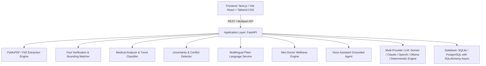

# MedCorpus AI — Backend API Documentation
**Hackathon:** CBC 2.0 | **Team Name:** BINARY BUILDERS | **Team ID:** CBC060 | **Domain:** AI & ML  
**Problem Statement 17:** Intelligent Medical Report Summarization

---

## 🌟 Overview
MedCorpus AI summarizes lengthy, complex diagnostic medical reports into structured, plain-language summaries while **strictly separating extracted facts from generated interpretations** and linking every biomarker to its verifiable source passage.

## 🚀 Key Application Architecture & Tech Stack



---

## 📋 API Endpoints Reference

### 1. Reports & Extraction
- `POST /api/reports/upload`
  - Multipart form upload of PDF or image report.
  - Performs page-by-page extraction using **PyMuPDF**, biomarker identification, character-by-character value verification against source text, uncertainty detection, and DB persistence.
- `GET /api/reports/sample`
  - Fetches the verified sample medical report (CBC, Metabolic, Vitamin & Thyroid panels).
- `GET /api/reports/{id}`
  - Fetches full report summary, findings, visual positions, trends, uncertainty flags, and page passages.

### 2. Voice Assistant
- `POST /api/voice/query`
  - Input: `{ question: string, report_id?: string }`
  - Output: Spoken text response grounded strictly in the report, citing exact page number, matched quote, and highlight target.
- `GET /api/voice/sample-questions`
  - Returns suggested voice questions.

### 3. Multilingual Plain Language & Translation
- `POST /api/plain-language/explain`
  - Input: `{ text: string, language: "English" | "Hindi" | "Kannada" | "Spanish" | "French" | "German", mode: "layman" | "clinical" }`
  - Output: Plain-language or clinical explanation of medical terms in the requested language.
- `GET /api/plain-language/languages`
  - Lists supported languages and modes.

### 4. Uncertainty & Conflict Flags
- `GET /api/flags/{report_id}`
  - Returns flagged ambiguities (e.g. date conflicts across pages, missing fasting confirmation, variable reference intervals).
- `POST /api/flags/{flag_id}/resolve`
  - Marks an uncertainty flag as reviewed.

### 5. Mini Doctor Box
- `GET /api/mini-doctor/plans`
  - Structured general wellness suggestions: Routine, Diet, and Nutrition grounded in abnormal test results with responsible safety limits.
- `POST /api/mini-doctor/chat`
  - Safe wellness assistant answering questions grounded strictly in the report with medical disclaimers.

### 6. Authentication
- `POST /api/auth/signup`
- `POST /api/auth/login`
- `GET /api/auth/me`
- `POST /api/auth/forgot-password`

---

## 🛠️ Running the Backend Locally

### 1. Activate Virtual Environment & Install Dependencies
```bash
cd backend
source venv/bin/activate
pip install -r requirements.txt
```

### 2. Start the FastAPI Server
```bash
python run.py
# Server starts at: http://localhost:8000
# Interactive Swagger Documentation: http://localhost:8000/docs
```

### 3. Run Automated Test Suite
```bash
source backend/venv/bin/activate
python backend/tests/test_api.py
```
